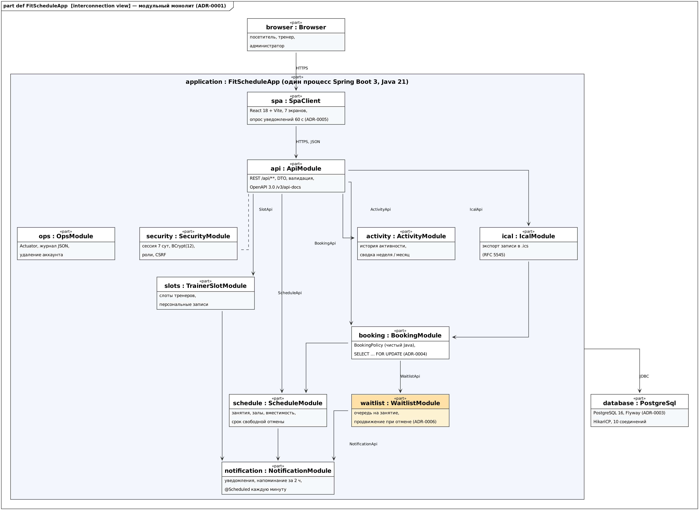
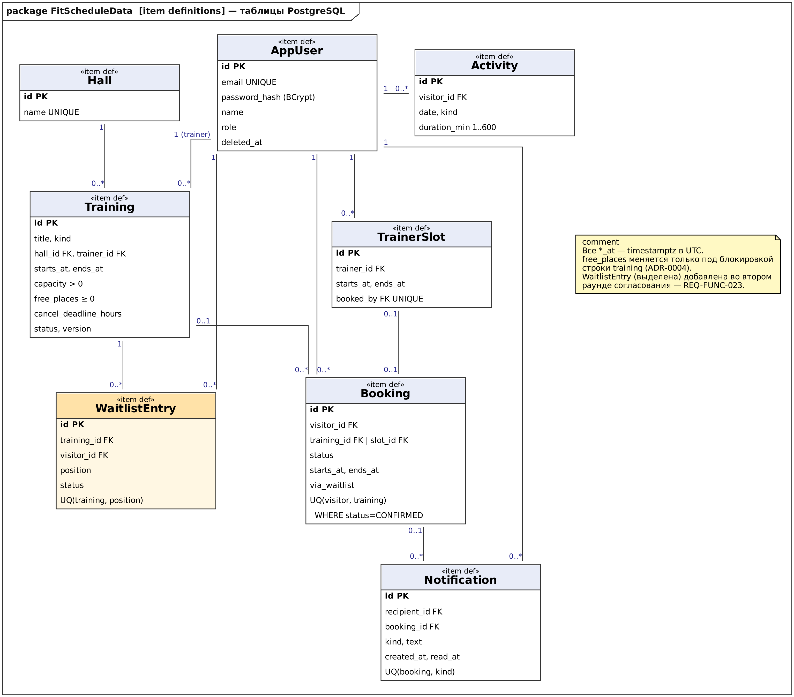
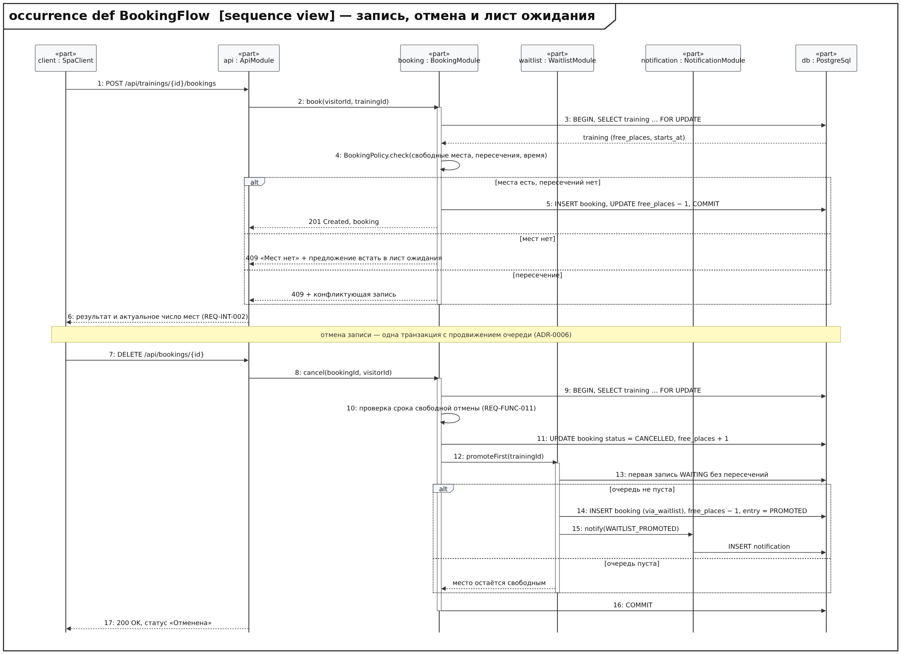
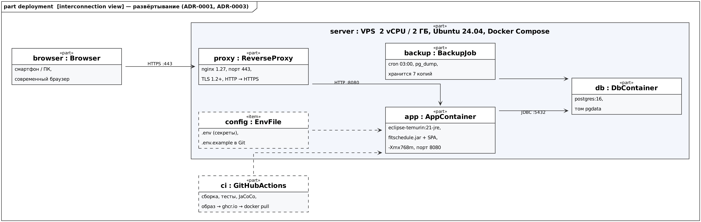

# Описание дизайна программного обеспечения

Для FitSchedule — web-приложения для управления расписанием фитнес-клуба и записью на тренировки

Версия 0.2

Подготовил Лесковский Е. Е., гр. 450501

БГУИР, факультет КСиС, кафедра ЭВМ

03.11.2026

## Оглавление

<!-- TOC -->
* [1. Введение](#1-introduction)
  * [1.1 Назначение документа](#11-document-purpose)
  * [1.2 Область применения](#12-subject-scope)
  * [1.3 Определения, акронимы и сокращения](#13-definitions-acronyms-and-abbreviations)
  * [1.4 Ссылки](#14-references)
  * [1.5 Обзор документа](#15-document-overview)
* [2. Обзор дизайна](#2-design-overview)
  * [2.1 Задачи стейкхолдеров](#21-stakeholder-concerns)
  * [2.2 Выбранные точки зрения](#22-selected-viewpoints)
* [3. Проектные представления](#3-design-views)
* [4. Решения](#4-decisions)
* [5. Приложения](#5-appendixes)
<!-- TOC -->

## История изменений

| Name | Date | Reason For Changes | Version |
|------|------|--------------------|---------|
| Лесковский Е. Е. | 30.10.2026 | Первая редакция по SRS 0.1.1: модули, модель данных, запись и отмена, развёртывание, ADR-0001…0004 | 0.1 |
| Лесковский Е. Е. | 03.11.2026 | По итогам согласования плана: опрос уведомлений вместо WebSocket (ADR-0005), лист ожидания REQ-FUNC-023 в модели данных, алгоритме и последовательности (ADR-0006), кабинет тренера исключён из 1.0, экспорт .ics возвращён | 0.2 |

---

## 1. Введение {#1-introduction}

Документ описывает, **КАК** устроено web-приложение FitSchedule 1.0, требования к которому зафиксированы в
[`../srs/srs.md`](../srs/srs.md) (версия 0.2). SRS отвечает на вопрос «что должна делать система», SDD — «из
каких частей она состоит и как они взаимодействуют», ADR — «почему выбран именно такой вариант».

### 1.1 Назначение документа {#11-document-purpose}

SDD — руководство для команды разработки (Исполнитель и junior-разработчик на учебной практике) при реализации версии 1.0 по плану
[`../plan/iteration-plan.md`](../plan/iteration-plan.md). Заказчик использует документ при обсуждении сроков:
оценки функций опираются на описанные здесь модули. Преподаватель проверяет по нему трассируемость к SRS,
сопровождающий — порядок развёртывания и распределение ресурсов (представления 009, 010). Значимые решения
вынесены в каталог [`../adr`](../adr).

### 1.2 Область применения {#12-subject-scope}

Проектируется FitSchedule 1.0 целиком: клиентская часть в браузере, REST API, серверная логика расписания,
записи, слотов тренеров и листа ожидания, история активности, внутрисистемные уведомления и напоминания,
экспорт записи в iCalendar, база данных и развёртывание.

**Не входит в версию 1.0** (SRS, раздел 2.6): кабинет тренера (REQ-FUNC-017), автоматический учёт посещённых
занятий (REQ-FUNC-020), поиск по названию занятия, шаблон недели для слотов тренера, графики активности, оплата,
мобильные приложения, доставка уведомлений вне сайта (e-mail, push).

### 1.3 Определения, акронимы и сокращения {#13-definitions-acronyms-and-abbreviations}

| Term | Definition |
|------|------------|
| ADR | Architecture Decision Record — запись архитектурного решения (формат MADR) |
| DTO | Data Transfer Object — объект передачи данных между API и клиентом |
| Flyway | инструмент версионных миграций схемы БД |
| FOR UPDATE | режим `SELECT`, блокирующий выбранные строки до конца транзакции |
| Partial unique index | уникальный индекс PostgreSQL с условием `WHERE`, например только для активных записей |
| SDD | Software Design Description — описание дизайна ПО (IEEE 1016) |
| SPA | Single Page Application — клиент, работающий в браузере и обращающийся к REST API |
| Short polling | периодический запрос клиента к серверу (здесь — раз в 60 с) вместо постоянного соединения |
| Лист ожидания | очередь посетителей на заполненное занятие (REQ-FUNC-023) |
| Модульный монолит | одно развёртываемое приложение, разделённое на модули с явными границами |

Термины предметной области (слот, запись, вместимость, срок свободной отмены) — в SRS, раздел 1.3.

### 1.4 Ссылки {#14-references}

| Документ | Версия / дата | Расположение | Статус |
|----------|---------------|--------------|--------|
| SRS FitSchedule | 0.2, 03.11.2026 | `docs/srs/srs.md` | нормативная |
| План реализации и переписка с Заказчиком | 1.0, 03.11.2026 | `docs/plan/iteration-plan.md`, `docs/plan/correspondence.md` | нормативная |
| ADR-0001…0006 | 2026-10/11 | `docs/adr/` | нормативная |
| Шаблон SDD курса ЖЦРПО | 2026 | ветка `ProjectTemplate`, `sdd/sdd-template.md` | нормативная |
| IEEE 1016-2009 Software Design Descriptions | 2009 | ieee.org | справочная |
| ISO/IEC/IEEE 42010:2011 Architecture description | 2011 | iso.org | справочная |
| OMG SysML v2.0 | 2025 | omg.org/spec/SysML | справочная |
| Модели SysML v2 дизайна | 0.2 | `docs/sdd/models/*.sysml` | справочная |

### 1.5 Обзор документа {#15-document-overview}

Раздел 2 перечисляет стейкхолдеров и выбранные точки зрения, раздел 3 — проектные представления с
идентификаторами `NNN-название` и ссылками на требования SRS и ADR, раздел 4 — краткое изложение решений (полные
записи — в `docs/adr`), раздел 5 — матрица трассировки «функция плана → модуль / представление → требование».
Диаграммы выполнены на SysML v2: тексты моделей — в `docs/sdd/models`, изображения — в `docs/sdd/img`.
Изменения вносятся через pull request и отражаются в «Истории изменений».

---

## 2. Обзор дизайна {#2-design-overview}

### 2.1 Задачи стейкхолдеров {#21-stakeholder-concerns}

| Стейкхолдер | Задачи (concerns) | Где адресуется |
|-------------|-------------------|----------------|
| Заказчик (клуб) | выпуск 02.05.2027, нулевая стоимость, отсутствие двойных записей, понятные оценки | 002, 005, 006; ADR-0001, ADR-0004; план |
| Посетитель | быстро записаться с телефона, видеть свободные места, не потерять место при отмене другого | 004, 005, 006, 007 |
| Тренер | видеть свои слоты, не получать двойных броней | 003, 006 |
| Администратор | вести расписание, вместимость и сроки отмены, отменять занятия | 004, 007 |
| Исполнитель | границы модулей, контракты, тестируемость правил записи | 002, 004, 006, 011; ADR-0001 |
| Junior-разработчик | изолированные задачи, понятные интерфейсы и данные | 002, 003, 004 |
| Сопровождающий | запуск одной командой, ресурсы 2 vCPU / 2 ГБ, резервные копии, журналы | 009, 010; ADR-0003 |
| Преподаватель | соответствие шаблонам и трассируемость к SRS | раздел 5 |

### 2.2 Выбранные точки зрения {#22-selected-viewpoints}

Язык представлений — SysML v2 (текстовая нотация в `docs/sdd/models`, графическая — PNG), дополнительно таблицы и
псевдокод.

#### 2.2.1 Контекст {#221-context}

Используется: представление **001-context**. Система как «чёрный ящик», роли пользователей и внешние программы.

#### 2.2.2 Композиция {#222-composition}

Используется: **002-modules** — модули монолита и клиентская часть (SysML v2 interconnection view).

#### 2.2.3 Логическое представление {#223-logical}

Не выделяется отдельно: основные типы совпадают с сущностями представления 003 и портами модулей 002.
Классы уточняются в коде (доменные классы модулей `booking` и `waitlist`).

#### 2.2.4 Физическое представление {#224-physical}

Объединено с развёртыванием в **009-deployment**: один сервер, отдельной аппаратной топологии нет.

#### 2.2.5 Структура {#225-structure}

Покрывается **002-modules**: порты (`ScheduleApi`, `BookingApi`, `WaitlistApi`, `NotificationApi` и др.) и
соединения между модулями.

#### 2.2.6 Зависимости {#226-dependency}

Покрывается **002-modules** (стрелки «использует») и правилом ADR-0001: модуль обращается к другому только через
порт, правила `BookingPolicy` не зависят от Spring; проверяется тестами ArchUnit.

#### 2.2.7 Информация {#227-information}

Используется: **003-data-model** — таблицы PostgreSQL как `item def` SysML v2.

#### 2.2.8 Интерфейс {#228-interface}

Используется: **004-interface** — маршруты REST API и контракт с клиентом.

#### 2.2.9 Взаимодействие {#229-interaction}

Используется: **005-booking-flow** — последовательность «запись» и «отмена с продвижением листа ожидания».

#### 2.2.10 Алгоритм {#2210-algorithm}

Используется: **006-booking-algorithm** — проверки при записи, отмена и выбор первого подходящего из очереди.

#### 2.2.11 Динамика состояний {#2211-state-dynamics}

Используется: **007-booking-states** — жизненный цикл записи и элемента листа ожидания.

#### 2.2.12 Параллелизм {#2212-concurrency}

Используется: **008-concurrency** — HTTP-запросы, планировщик напоминаний, резервное копирование.

#### 2.2.13 Паттерны {#2213-patterns}

Используется: **011-patterns**.

#### 2.2.14 Развёртывание {#2214-deployment}

Используется: **009-deployment** — контейнеры Docker Compose на учебном сервере.

#### 2.2.15 Ресурсы {#2215-resources}

Используется: **010-resources** — распределение памяти, соединений и потоков в пределах 2 vCPU / 2 ГБ.

---

## 3. Проектные представления {#3-design-views}

### 001-context

- **ID:** 001-context
- **Title:** Контекст системы
- **Viewpoint:** Context
- **Representation:** посетитель, тренер и администратор работают с FitSchedule через браузер по HTTPS
  (REQ-SEC-002). Внешних онлайн-сервисов в версии 1.0 нет: календарь посетителя получает файл `.ics`, который
  посетитель скачивает сам (REQ-INT-007). Данные хранятся в PostgreSQL на том же сервере. Структура системы и
  варианты использования из SRS — [`../srs/img/sysml.png`](../srs/img/sysml.png),
  модель [`../srs/model.sysml`](../srs/model.sysml).
- **More Information:** REQ-INT-001, REQ-INT-008 (при сбое необязательных частей запись продолжает работать).

### 002-modules

- **ID:** 002-modules
- **Title:** Модули модульного монолита и их интерфейсы
- **Viewpoint:** Composition, Structure, Dependency
- **Representation:** 
  *Рисунок 1 — `part def FitScheduleApp`. Модель: [`models/architecture.sysml`](models/architecture.sysml)*

  | Модуль | Ответственность | Требования |
  |--------|-----------------|------------|
  | `spa` | React-клиент: 7 экранов из макетов SRS, формы с сообщениями у поля, опрос уведомлений | REQ-INT-001…005 |
  | `api` | REST-контроллеры, DTO, валидация, единый формат ошибок, OpenAPI 3.0 | REQ-INT-006, REQ-SEC-004 |
  | `security` | регистрация, вход, сессия 7 суток, BCrypt, роли, CSRF | REQ-FUNC-001…003, REQ-SEC-001/002 |
  | `schedule` | занятия, залы, вместимость, срок свободной отмены, отмена занятия клубом | REQ-FUNC-004…006/012, REQ-REL-003 |
  | `booking` | запись и отмена; правила `BookingPolicy` (места, пересечения, сроки) | REQ-FUNC-007…011/013, REQ-REL-001 |
  | `slots` | слоты тренеров, бронирование персональной тренировки | REQ-FUNC-014…016 |
  | `waitlist` | лист ожидания, продвижение очереди при отмене | REQ-FUNC-023 |
  | `activity` | ввод активности, история, сводка за неделю и месяц | REQ-FUNC-018/019 |
  | `notification` | уведомления об отмене и изменении, напоминание за 2 ч, счётчик непрочитанных | REQ-FUNC-021/022 |
  | `ical` | файл `.ics` для подтверждённой записи (RFC 5545) | REQ-INT-007 |
  | `ops` | Actuator, журнал JSON без персональных данных, удаление аккаунта | REQ-OBS-001, REQ-SEC-005, REQ-COMP-003 |

  Правила зависимостей: модуль обращается к другому только через его интерфейс (порт); `booking` вызывает
  `schedule` и `waitlist`, но не наоборот; `notification` ни от кого не зависит, его вызывают остальные модули.
- **More Information:** ADR-0001, ADR-0002. Функции плана F-01…F-18 распределены по модулям в разделе 5.

### 003-data-model

- **ID:** 003-data-model
- **Title:** Модель данных
- **Viewpoint:** Information
- **Representation:** 
  *Рисунок 2 — `package FitScheduleData`. Модель: [`models/data-model.sysml`](models/data-model.sysml)*

  Ключевые правила целостности:
  - `training.free_places` меняется только в транзакции, которая заблокировала строку занятия
    (`SELECT … FOR UPDATE`); `CHECK (free_places BETWEEN 0 AND capacity)` (REQ-FUNC-008, REQ-REL-001);
  - частичный уникальный индекс `booking (visitor_id, training_id) WHERE status = 'CONFIRMED'` исключает повторную
    запись одного посетителя на одно занятие;
  - `trainer_slot.booked_by` — уникальная ссылка: слот может занять только один посетитель (REQ-FUNC-016);
  - в `booking` хранятся копии `starts_at` и `ends_at`, чтобы проверка пересечений (REQ-FUNC-009) выполнялась одним
    запросом по записям посетителя;
  - `waitlist_entry (training_id, position)` уникален, у посетителя не более одной позиции `WAITING` на занятие;
  - `notification (booking_id, kind)` уникален для напоминаний: одно напоминание на запись (REQ-FUNC-022);
  - все поля `*_at` — `timestamptz` в UTC; схема ведётся миграциями Flyway `V1__…` (REQ-INST-001).
- **More Information:** ADR-0003, ADR-0004, ADR-0006. Таблица `waitlist_entry` добавлена в версии 0.2 по итогам
  второго раунда согласования.

### 004-interface

- **ID:** 004-interface
- **Title:** Маршруты REST API
- **Viewpoint:** Interface
- **Representation:**

  | Метод и маршрут | Назначение | Ответ и ошибки | Требования |
  |-----------------|------------|----------------|------------|
  | `POST /api/auth/register`, `POST /api/auth/login`, `POST /api/auth/logout` | регистрация, вход, выход | 201 / 204; 400 слабый пароль; 409 email занят | REQ-FUNC-001/002 |
  | `GET /api/trainings?from=&to=&kind=&trainerId=` | расписание с фильтрами | 200, список с `freePlaces` | REQ-FUNC-004, REQ-INT-003/004 |
  | `POST /api/trainings`, `PUT /api/trainings/{id}`, `POST /api/trainings/{id}/cancel` | управление расписанием | 403 не администратору; 422 ошибки ввода | REQ-FUNC-005/006, REQ-SEC-004 |
  | `POST /api/trainings/{id}/bookings` | запись на занятие | 201; **409** мест нет / пересечение | REQ-FUNC-007…009 |
  | `GET /api/me/bookings?status=` | мои записи | 200, предстоящие и отменённые | REQ-FUNC-010 |
  | `DELETE /api/bookings/{id}` | отмена записи посетителем | 200; 409 после срока свободной отмены; 404 чужая | REQ-FUNC-011, REQ-SEC-003 |
  | `POST /api/admin/bookings/{id}/cancel` | отмена администратором | 200; запись в журнал | REQ-FUNC-013 |
  | `POST /api/trainings/{id}/waitlist`, `DELETE /api/trainings/{id}/waitlist` | встать в лист ожидания / выйти | 201 с позицией; 409, если места есть | REQ-FUNC-023 |
  | `GET /api/trainers/{id}/slots`, `POST /api/slots`, `POST /api/slots/{id}/booking` | слоты и персональная запись | 409 слот занят | REQ-FUNC-014…016 |
  | `GET/POST /api/me/activities`, `GET /api/me/activities/summary?period=week` | активность и сводка | 422 длительность вне 1…600 | REQ-FUNC-018/019 |
  | `GET /api/me/notifications`, `GET /api/me/notifications/unread-count`, `POST /api/me/notifications/{id}/read` | уведомления и напоминания | 200 | REQ-FUNC-021/022 |
  | `GET /api/bookings/{id}/calendar.ics` | файл календаря | `text/calendar` | REQ-INT-007 |
  | `GET /v3/api-docs` | спецификация OpenAPI | JSON | REQ-INT-006 |

  Изменяющие запросы требуют CSRF-токен; ошибки возвращаются в формате RFC 7807 (`application/problem+json`) с
  полем `field` для ошибок ввода, которые клиент показывает рядом с полем (REQ-INT-005).
- **More Information:** макеты экранов — SRS, раздел 5.2; ADR-0002, ADR-0005.

### 005-booking-flow

- **ID:** 005-booking-flow
- **Title:** Запись на занятие и отмена с продвижением листа ожидания
- **Viewpoint:** Interaction
- **Representation:** 
  *Рисунок 3 — `occurrence def BookingFlow`. Модель: [`models/booking-flow.sysml`](models/booking-flow.sysml)*

  Шаги 1–6 — запись: строка занятия блокируется, проверки выполняются под блокировкой, запись и уменьшение числа
  мест фиксируются одной транзакцией. Шаги 7–17 — отмена: место освобождается и в той же транзакции отдаётся
  первому подходящему посетителю из листа ожидания, которому создаётся уведомление. Пути отказа: нет мест — 409 с
  предложением встать в очередь; пересечение — 409 с конфликтующей записью; срок свободной отмены истёк — 409.
- **More Information:** REQ-FUNC-007…011, REQ-FUNC-023, REQ-REL-001, REQ-PERF-002; ADR-0004, ADR-0006.

### 006-booking-algorithm

- **ID:** 006-booking-algorithm
- **Title:** Правила записи, отмены и продвижения очереди
- **Viewpoint:** Algorithm
- **Representation:** владелец — `booking.BookingPolicy` (чистые функции, время передаётся через
  `java.time.Clock` для тестов) и `waitlist.WaitlistService`.

  ```text
  book(visitor, trainingId, now):
      t ← SELECT * FROM training WHERE id = trainingId FOR UPDATE          // ADR-0004
      if t.status = CANCELLED or t.startsAt ≤ now: reject 409 "занятие недоступно"
      if t.freePlaces = 0: reject 409 "мест нет", offer waitlist            // REQ-FUNC-008
      c ← первая запись visitor со статусом CONFIRMED, у которой
          startsAt < t.endsAt and t.startsAt < endsAt                       // REQ-FUNC-009
      if c ≠ null: reject 409 conflict(c)
      INSERT booking(visitor, t, CONFIRMED, t.startsAt, t.endsAt)
      t.freePlaces ← t.freePlaces − 1                                       // REQ-FUNC-007

  cancel(booking, actor, now):
      t ← SELECT … FOR UPDATE
      if actor = visitor and now > t.startsAt − t.cancelDeadlineHours: reject 409   // REQ-FUNC-011
      booking.status ← CANCELLED;  t.freePlaces ← t.freePlaces + 1
      promoteFirst(t, now)                                                  // REQ-FUNC-023, ADR-0006

  promoteFirst(t, now):
      if t.startsAt − now < 30 мин: return                                  // поздно переносить место
      for e in waitlist WHERE training = t AND status = WAITING ORDER BY position:
          if у e.visitor нет пересечений с t:
              INSERT booking(e.visitor, t, CONFIRMED, viaWaitlist = true)
              t.freePlaces ← t.freePlaces − 1;  e.status ← PROMOTED
              notify(e.visitor, WAITLIST_PROMOTED)
              return
          e.status ← EXPIRED                                                // посетитель уже занят
  ```

  Сложность — O(K) по длине очереди (на практике не более вместимости зала). Граничные случаи — последнее место,
  отмена ровно в момент срока, пересечение у первого в очереди, отмена занятия клубом (вся очередь получает
  `EXPIRED`) — покрываются параметризованными тестами `BookingPolicyTest` и `WaitlistServiceTest`.
- **More Information:** REQ-FUNC-007…011/013/023; ADR-0004, ADR-0006.

### 007-booking-states

- **ID:** 007-booking-states
- **Title:** Жизненный цикл записи и элемента листа ожидания
- **Viewpoint:** State Dynamics
- **Representation:**

  | Объект | Состояние | Переход | Событие |
  |--------|-----------|---------|---------|
  | Запись | `CONFIRMED` | → `CANCELLED` | отмена посетителем до срока или администратором после срока |
  | Запись | `CONFIRMED` | → `CANCELLED_BY_CLUB` | отмена занятия администратором (REQ-FUNC-006, REQ-REL-003) |
  | Запись | `CONFIRMED` | → `ATTENDED` | окончание занятия (фиксируется планировщиком, используется в будущем REQ-FUNC-020) |
  | Лист ожидания | `WAITING` | → `PROMOTED` | освободилось место, пересечений нет |
  | Лист ожидания | `WAITING` | → `LEFT` | посетитель вышел из очереди |
  | Лист ожидания | `WAITING` | → `EXPIRED` | занятие началось, отменено или у посетителя пересечение |

  Конечные состояния не меняются. Перечисления совпадают с `BookingStatus` и `WaitlistStatus` модели данных.
- **More Information:** модель [`../srs/model.sysml`](../srs/model.sysml) (`BookingStatus`); REQ-FUNC-006,
  REQ-FUNC-023.

### 008-concurrency

- **ID:** 008-concurrency
- **Title:** Параллельные процессы и синхронизация
- **Viewpoint:** Concurrency
- **Representation:**

  | Процесс | Потоки | Синхронизация |
  |---------|--------|---------------|
  | HTTP-запросы | пул Tomcat, до 100 потоков | запись, отмена и продвижение очереди блокируют строку `training` (`FOR UPDATE`); слоты — уникальный `booked_by` |
  | Напоминания за 2 ч | 1 поток `@Scheduled`, раз в минуту | `INSERT … ON CONFLICT DO NOTHING` по уникальному `(booking_id, kind)` |
  | Отметка `ATTENDED` | 1 поток, раз в 15 минут | обновление пакетами по 500 строк |
  | Опрос уведомлений клиентом | запрос `unread-count` раз в 60 с | только чтение, индекс `(recipient_id, read_at)` |
  | Резервная копия | cron вне JVM, 03:00 | `pg_dump` со снимком, запись не блокируется |

  Порядок блокировок один для всех операций — сначала `training`, затем `booking` и `waitlist_entry`, поэтому
  взаимные блокировки исключены. Таймаут ожидания блокировки — 2 с (REQ-PERF-002).
- **More Information:** REQ-REL-001, REQ-PERF-002, раздел 3.5.9 SRS; ADR-0004, ADR-0005.

### 009-deployment

- **ID:** 009-deployment
- **Title:** Развёртывание
- **Viewpoint:** Deployment, Physical
- **Representation:** 
  *Рисунок 4 — `part deployment`. Модель: [`models/architecture.sysml`](models/architecture.sysml)*

  Docker Compose на одном сервере: `proxy` (nginx, HTTPS :443), `app` (eclipse-temurin:21-jre, `fitschedule.jar`
  вместе со статическими файлами SPA), `db` (postgres:16, том `pgdata`), `backup` (cron + `pg_dump`). Секреты — в
  `.env` (пример — `.env.example`, REQ-INST-001). Образ собирается GitHub Actions и публикуется в ghcr.io
  (REQ-BUILD-001). Окружения: локальное (`docker compose up`) и учебный сервер.
- **More Information:** REQ-INST-001, REQ-BUILD-001, REQ-SEC-002; ADR-0001, ADR-0003.

### 010-resources

- **ID:** 010-resources
- **Title:** Ресурсы сервера 2 vCPU / 2 ГБ
- **Viewpoint:** Resources
- **Representation:**

  | Ресурс | Распределение | Обоснование |
  |--------|---------------|-------------|
  | Память app | `-Xmx768m`, итог процесса ≈ 900 МБ | REQ-PERF-002/003 |
  | Память db | `shared_buffers = 256MB`, итог ≈ 400 МБ | данные 1.0 — десятки МБ |
  | nginx и ОС | ≈ 30 МБ + ≈ 300 МБ | — |
  | Соединения с БД | HikariCP 10 | транзакции записи короткие (< 50 мс) |
  | Пакеты | отметка `ATTENDED` — 500 строк | ограничение пиковой памяти |
  | Журналы | JSON, ротация, 14 дней | REQ-OBS-001 |

  Суммарно ≈ 1,6 ГБ из 2 ГБ; при нехватке первым уменьшается `-Xmx` до 640 МБ.
- **More Information:** REQ-PERF-001…003; проверяется нагрузочным тестом F-17 (50 параллельных записей,
  200 занятий в неделю).

### 011-patterns

- **ID:** 011-patterns
- **Title:** Применённые паттерны
- **Viewpoint:** Patterns
- **Representation:**

  | Паттерн | Где | Зачем |
  |---------|-----|-------|
  | Модульный монолит | всё приложение | границы модулей без накладных расходов микросервисов (ADR-0001) |
  | SPA + REST | `spa`, `api` | одно API для клиента и интеграций (ADR-0002, REQ-INT-006) |
  | Pessimistic locking | `booking`, `waitlist` | нет двойных записей и переполнения (ADR-0004) |
  | Domain policy (чистые функции + `Clock`) | `BookingPolicy` | детерминированные тесты граничных случаев |
  | Repository (Spring Data JPA) | все модули с данными | единый доступ к БД |
  | Short polling | `spa`, `notification` | уведомления без постоянного соединения (ADR-0005) |
- **More Information:** REQ-MAINT-002, раздел 3.5.5 SRS (модуль бронирования отделён от web-слоя).

---

## 4. Решения {#4-decisions}

Полные записи — в каталоге [`../adr`](../adr) (формат MADR).

- **ID:** 0001-modular-monolith-spring-boot
- **Title:** Модульный монолит на Spring Boot вместо микросервисов
- **Context:** 1–2 студента-разработчика, 100 ч работы, один сервер 2 vCPU / 2 ГБ, запуск одной командой, независимый модуль бронирования.
- **Options:** модульный монолит; микросервисы; слоистый монолит без модулей.
- **Outcome:** «модульный монолит», потому что укладывается в ресурсы и срок и при этом сохраняет границы модулей.
- **More Information:** [`../adr/0001-modular-monolith-spring-boot.md`](../adr/0001-modular-monolith-spring-boot.md); 002, 009.

- **ID:** 0002-react-spa-with-rest-api
- **Title:** Клиент React SPA поверх REST API
- **Context:** REQ-INT-006 требует, чтобы все операции интерфейса были доступны через REST API с OpenAPI.
- **Options:** React SPA + REST; серверный рендеринг Thymeleaf; Vaadin.
- **Outcome:** «React SPA + REST», потому что интерфейс и API используют один контракт и не дублируются.
- **More Information:** [`../adr/0002-react-spa-with-rest-api.md`](../adr/0002-react-spa-with-rest-api.md); 004.

- **ID:** 0003-postgresql-flyway
- **Title:** PostgreSQL 16 с миграциями Flyway
- **Context:** транзакции записи с блокировками, частичные уникальные индексы, время в UTC.
- **Options:** PostgreSQL 16; MySQL 8; MongoDB.
- **Outcome:** «PostgreSQL 16 + Flyway», потому что соответствует ограничению SRS 2.3 и даёт частичные индексы и `timestamptz`.
- **More Information:** [`../adr/0003-postgresql-flyway.md`](../adr/0003-postgresql-flyway.md); 003.

- **ID:** 0004-pessimistic-locking-for-booking
- **Title:** Пессимистическая блокировка строки занятия при записи
- **Context:** REQ-REL-001: при 100 одновременных запросах на последнее место — не более одной записи.
- **Options:** `SELECT … FOR UPDATE`; оптимистическая блокировка `@Version` с повтором; уровень `SERIALIZABLE`; `synchronized` в JVM.
- **Outcome:** «`SELECT … FOR UPDATE`», потому что гарантирует результат без повторов и работает при нескольких экземплярах.
- **More Information:** [`../adr/0004-pessimistic-locking-for-booking.md`](../adr/0004-pessimistic-locking-for-booking.md); 005, 006, 008.

- **ID:** 0005-notifications-short-polling
- **Title:** Уведомления через опрос раз в 60 секунд вместо WebSocket
- **Context:** сокращение трудоёмкости по просьбе Заказчика (раунд 1), REQ-FUNC-021 «в течение минуты».
- **Options:** short polling 60 с; WebSocket (STOMP); Server-Sent Events.
- **Outcome:** «short polling», потому что экономит 4 ч и выполняет требование «в течение минуты».
- **More Information:** [`../adr/0005-notifications-short-polling.md`](../adr/0005-notifications-short-polling.md); 004, 008.

- **ID:** 0006-waitlist-promotion-in-cancel-transaction
- **Title:** Продвижение листа ожидания в транзакции отмены
- **Context:** новая функция Заказчика (раунд 2): освободившееся место должно сразу перейти первому в очереди.
- **Options:** в той же транзакции; периодическая задача раз в минуту; предложение места с подтверждением за 2 ч.
- **Outcome:** «в той же транзакции», потому что место не «зависает» свободным и не нужна отдельная задача.
- **More Information:** [`../adr/0006-waitlist-promotion-in-cancel-transaction.md`](../adr/0006-waitlist-promotion-in-cancel-transaction.md); 003, 005, 006.

---

## 5. Приложения {#5-appendixes}

**Приложение А. Трассировка «функция плана → модуль / представление → требования»**

| Функция | Priority | Итерация | Модули / представления | Требования SRS |
|---------|----------|----------|------------------------|----------------|
| F-01 Project skeleton & CI | 10 | I1 | 009, 011 | REQ-INST-001, REQ-BUILD-001, REQ-MAINT-001 |
| F-02 Accounts & roles | 10 | I1 | `security`; 004 | REQ-FUNC-001…003, REQ-SEC-001/002, REQ-COMP-003 |
| F-03 Group schedule | 10 | I2 | `schedule`, `spa`; 004 | REQ-FUNC-004, REQ-INT-001/004 |
| F-04 Schedule management | 10 | I2 | `schedule`; 003, 007 | REQ-FUNC-005/006, REQ-REL-003, REQ-SEC-004 |
| F-10 Schedule filters | 30 | I2 | `spa`, `api`; 004 | REQ-INT-003/005, REQ-PERF-001 |
| F-15 REST API & OpenAPI | 20 | I2 | `api`; 004 | REQ-INT-006 |
| F-05 Group class booking | 10 | I3 | `booking`; 005, 006, 008 | REQ-FUNC-007…009, REQ-INT-002, REQ-REL-001, REQ-PERF-002 |
| F-06 My bookings & cancellation | 10 | I3 | `booking`; 004, 007 | REQ-FUNC-010/011 |
| F-16 Operations & logging | 30 | I3 | `ops`; 009, 010 | REQ-OBS-001, REQ-SEC-005, REQ-REL-002, REQ-PERF-003 |
| F-07 Cancellation deadlines | 20 | I4 | `schedule`, `booking`; 006 | REQ-FUNC-012/013 |
| F-08 Trainer slots & personal booking | 10 | I4 | `slots`; 003, 004 | REQ-FUNC-014…016 |
| F-11 Activity log & summary | 20 | I4 | `activity`; 004 | REQ-FUNC-018/019 |
| F-13 Notifications & reminders | 20 | I5 | `notification`; 008 | REQ-FUNC-021/022, REQ-INT-008 |
| F-18 Waitlist | 20 | I5 | `waitlist`; 003, 005, 006, 007 | REQ-FUNC-023 |
| F-14 Calendar export (.ics) | 30 | I6 | `ical`; 004 | REQ-INT-007 |
| F-17 Acceptance & load testing | 10 | I6 | 010 | REQ-PERF-001…003, REQ-SEC-003, REQ-MAINT-002 |

**Приложение Б. Модели SysML v2 и изображения**

| Файл | Содержание |
|------|------------|
| [models/architecture.sysml](models/architecture.sysml) | модули, порты, соединения, узлы развёртывания и `allocate` |
| [models/data-model.sysml](models/data-model.sysml) | `item def` таблиц, перечисления ролей и статусов |
| [models/booking-flow.sysml](models/booking-flow.sysml) | `occurrence def BookingFlow`: участники, сообщения, порядок |
| [img/components.png](img/components.png) | рисунок 1 — модули |
| [img/data-model.png](img/data-model.png) | рисунок 2 — модель данных |
| [img/booking-flow.png](img/booking-flow.png) | рисунок 3 — запись, отмена и лист ожидания |
| [img/deployment.png](img/deployment.png) | рисунок 4 — развёртывание |
